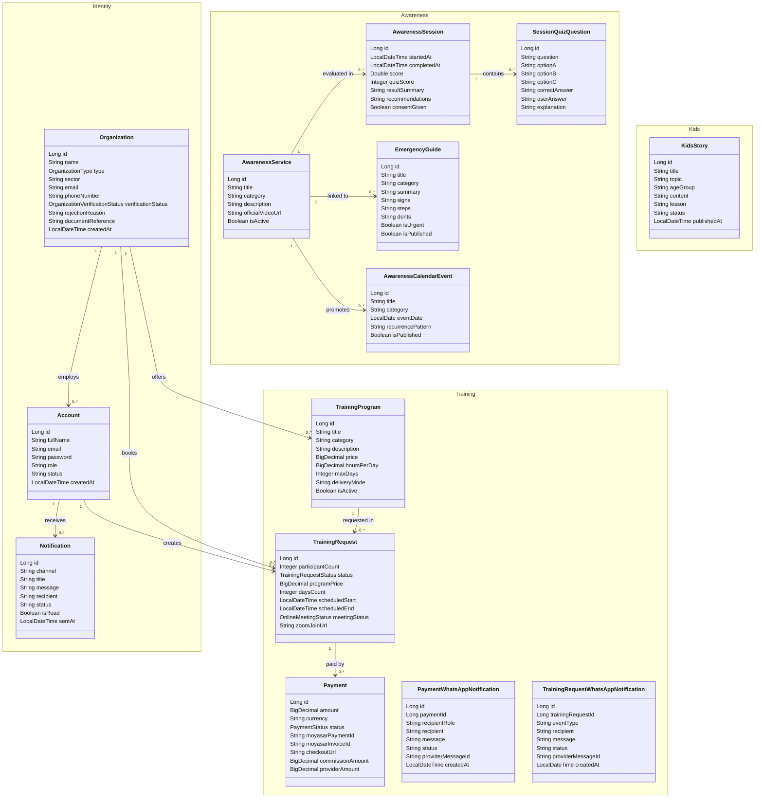

# WAEI · واعي

A B2B platform connecting training providers with organizations and beneficiaries — AI-assisted awareness training, emergency guidance, and a dedicated kids mode.


[](http://waei-platform-env.eba-zgnky3i6.eu-north-1.elasticbeanstalk.com/)

[Overview](#overview) · [Tech Stack](#tech-stack) · [Domain Model](#domain-model) · [API Reference](#api-reference) · [Project Structure](#project-structure) · [Getting Started](#getting-started) · [Deployment](#deployment) · [Integrations](#integrations)

## Resources

| Resource | Link |
| --- | --- |
| API collection | [`assets/Waei-Platform.postman_collection.json`](assets/Waei-Platform.postman_collection.json) — import into Postman |
| Presentation | [Canva slides](https://canva.link/90f054m1899z21j) |
| Design | [Figma file](https://www.figma.com/design/qWjdS6gkDwhqASp1PDxMhd/Untitled?node-id=0-1&t=39SmAtJ4BIQKtqxv-1) |
| Use case diagram | [`assets/use-case.jpg`](assets/use-case.jpg) |

## Overview

- **Marketplace** — providers publish training programs; organizations book, pay, and track delivery.
- **AI training loop** — upload a training video, get Gemini feedback, then take an auto-generated quiz with a score and recommendations.
- **Awareness** — emergency guide with AI smart search, awareness services, and a seasonal awareness calendar.
- **Kids mode** — AI stories with narration, a detective game, drawing review, and emergency-number practice.
- **Operations** — Moyasar invoices and refunds, Zoom meetings, WhatsApp/email notifications, and n8n reminders.

<details>
<summary><b>Use case diagram</b></summary>

<br />


</details>

## Tech Stack

| Layer | Technology |
| --- | --- |
| Language | Java 17 |
| Framework | Spring Boot 4.1.1 — Web MVC, Security, Data JPA, Validation, Mail, Thymeleaf |
| Auth | JWT (HS256) with OAuth2 Resource Server, BCrypt passwords, role-based access |
| Database | MySQL 8 (default), H2 (dev/test), Hibernate `ddl-auto=update` |
| AI | Google Gemini via `google-genai` — video evaluation, quizzes, smart search, stories, TTS, summaries |
| Payments | Moyasar — hosted invoices, webhook, refunds, 10% commission split |
| Meetings | Zoom API — automatic meeting creation for accepted requests |
| Messaging | UltraMsg (WhatsApp) and Spring Mail (SMTP) |
| Automation | n8n — 24-hour training reminders |
| Deployment | AWS — Elastic Beanstalk (`eu-north-1`, Stockholm) for the app, Amazon RDS MySQL 8 for the database |
| Frontend | Thymeleaf templates with vanilla CSS/JS |
| Build | Maven Wrapper |
| Tests | JUnit 5, Spring Boot Test, MockMvc |

```
Browser (Thymeleaf + vanilla JS)
        │  JWT
        ▼
REST API /api/v1/**  ──►  Service layer  ──►  JPA repositories  ──►  MySQL / H2
        │
        └──►  Gemini · Moyasar · Zoom · UltraMsg · SMTP · n8n
```

## Domain Model

14 JPA entities in one class diagram, grouped by domain. Expand it to view — GitHub renders Mermaid with zoom and pan.

<details>
<summary><b>Full domain model</b> — 14 entities</summary>

<br />



</details>

**Enums**

| Enum | Values |
| --- | --- |
| `OrganizationType` | `BENEFICIARY`, `PROVIDER`, `BOTH` |
| `OrganizationVerificationStatus` | `PENDING`, `VERIFIED`, `REJECTED` |
| `TrainingRequestStatus` | `PENDING`, `ACCEPTED`, `REJECTED`, `PAYMENT_PENDING`, `CONFIRMED`, `IN_PROGRESS`, `COMPLETED`, `CANCELLED` |
| `PaymentStatus` | `PENDING`, `PAID`, `FAILED`, `REFUNDED`, `CANCELLED` |
| `OnlineMeetingStatus` | `PENDING`, `CREATED`, `FAILED`, `DELETED` |

`KidsStory`, `PaymentWhatsAppNotification`, and `TrainingRequestWhatsAppNotification` are standalone records with no JPA relationships.

## API Reference

Base URL: `http://localhost:8080` · Auth header: `Authorization: Bearer <JWT>` · Token from `POST /api/v1/auth/login`.

**Access legend:** `Public` = no token, `Auth` = any authenticated account, `PLATFORM_ADMIN` / `ORG_ADMIN` = role required.

<details>
<summary><b>Auth</b> — 2 endpoints</summary>

<br />

| Method | Endpoint | Access | Purpose |
| --- | --- | --- | --- |
| `POST` | `/api/v1/auth/login` | Public | Authenticate and receive a JWT |
| `GET` | `/api/v1/auth/me` | Auth | Current account profile |

</details>

<details>
<summary><b>Accounts</b> — 6 endpoints</summary>

<br />

| Method | Endpoint | Access | Purpose |
| --- | --- | --- | --- |
| `GET` | `/api/v1/account/get` | PLATFORM_ADMIN | List all accounts |
| `GET` | `/api/v1/account/get-by-organization/{organizationId}` | PLATFORM_ADMIN | Accounts in an organization |
| `POST` | `/api/v1/account/add` | PLATFORM_ADMIN | Create an account |
| `PUT` | `/api/v1/account/update/{id}` | PLATFORM_ADMIN | Update an account |
| `PUT` | `/api/v1/account/status/{id}` | PLATFORM_ADMIN | Change account status |
| `DELETE` | `/api/v1/account/delete/{id}` | PLATFORM_ADMIN | Delete an account |

</details>

<details>
<summary><b>Organizations</b> — 10 endpoints</summary>

<br />

| Method | Endpoint | Access | Purpose |
| --- | --- | --- | --- |
| `GET` | `/api/v1/organization/get` | PLATFORM_ADMIN | List organizations |
| `GET` | `/api/v1/organization/get/{id}` | PLATFORM_ADMIN | Organization details |
| `GET` | `/api/v1/organization/registrations` | PLATFORM_ADMIN | Registrations by verification status |
| `POST` | `/api/v1/organization/register` | Public | Submit registration with document (multipart) |
| `POST` | `/api/v1/organization/{id}/resubmit` | Public | Resubmit a rejected registration |
| `PUT` | `/api/v1/organization/{id}/verify` | PLATFORM_ADMIN | Approve a registration |
| `PUT` | `/api/v1/organization/{id}/reject` | PLATFORM_ADMIN | Reject with a reason |
| `GET` | `/api/v1/organization/{id}/document` | PLATFORM_ADMIN | Download the registration document |
| `PUT` | `/api/v1/organization/update/{id}` | PLATFORM_ADMIN | Update an organization |
| `DELETE` | `/api/v1/organization/delete/{id}` | PLATFORM_ADMIN | Delete an organization |

</details>

<details>
<summary><b>Training Programs</b> — 13 endpoints</summary>

<br />

| Method | Endpoint | Access | Purpose |
| --- | --- | --- | --- |
| `GET` | `/api/v1/training-program/get` | Auth | List all programs |
| `GET` | `/api/v1/training-program/get/{id}` | Auth | Program details |
| `GET` | `/api/v1/training-program/get-active` | Public | List active programs |
| `GET` | `/api/v1/training-program/categories` | Public | Distinct categories |
| `GET` | `/api/v1/training-program/get-by-category/{category}` | Auth | Programs in a category |
| `GET` | `/api/v1/training-program/get-by-organization/{organizationId}` | Auth | Programs by provider |
| `POST` | `/api/v1/training-program/add` | Auth | Create a program |
| `PUT` | `/api/v1/training-program/update/{id}` | Auth | Update a program |
| `GET` | `/api/v1/training-program/{id}/image` | Public | Program cover image |
| `POST` | `/api/v1/training-program/{id}/image` | Auth | Upload cover image (multipart) |
| `DELETE` | `/api/v1/training-program/{id}/image` | Auth | Remove cover image |
| `PUT` | `/api/v1/training-program/change-status/{id}` | Auth | Toggle active status |
| `DELETE` | `/api/v1/training-program/delete/{id}` | Auth | Delete a program |

</details>

<details>
<summary><b>Training Requests</b> — 14 endpoints</summary>

<br />

| Method | Endpoint | Access | Purpose |
| --- | --- | --- | --- |
| `GET` | `/api/v1/training-request/get` | Auth | List all requests |
| `GET` | `/api/v1/training-request/get/{id}` | Auth | Request details |
| `GET` | `/api/v1/training-request/get-by-organization/{organizationId}` | Auth | Requests by organization |
| `GET` | `/api/v1/training-request/get-by-account/{accountId}` | Auth | Requests by account |
| `GET` | `/api/v1/training-request/get-by-program/{programId}` | Auth | Requests by program |
| `GET` | `/api/v1/training-request/get-by-status/{status}` | Auth | Requests by status |
| `GET` | `/api/v1/training-request/my-provider-requests` | Auth | Requests for the current provider |
| `POST` | `/api/v1/training-request/add` | Auth | Book a program |
| `PUT` | `/api/v1/training-request/update/{id}` | Auth | Update a request |
| `POST` | `/api/v1/training-request/{id}/accept` | Auth | Accept as provider |
| `POST` | `/api/v1/training-request/{id}/reject` | Auth | Reject as provider |
| `GET` | `/api/v1/training-request/{id}/meeting/host-link` | Auth | Zoom host link |
| `POST` | `/api/v1/training-request/{id}/cancel` | Auth | Cancel a request |
| `DELETE` | `/api/v1/training-request/delete/{id}` | Auth | Delete a request |

</details>

<details>
<summary><b>Payments</b> — 13 endpoints</summary>

<br />

| Method | Endpoint | Access | Purpose |
| --- | --- | --- | --- |
| `GET` | `/api/v1/payment/get` | Auth | List all payments |
| `GET` | `/api/v1/payment/get/{id}` | Auth | Payment details |
| `GET` | `/api/v1/payment/get-by-request/{trainingRequestId}` | Auth | Payments for a request |
| `GET` | `/api/v1/payment/get-by-status/{status}` | Auth | Payments by status |
| `GET` | `/api/v1/payment/get-by-moyasar/{moyasarPaymentId}` | Auth | Payment by Moyasar ID |
| `POST` | `/api/v1/payment/add` | Auth | Create an invoice and checkout URL |
| `POST` | `/api/v1/payment/{id}/refund` | Auth | Refund a payment |
| `POST` | `/api/v1/payment/{id}/sync` | Auth | Sync status with Moyasar |
| `POST` | `/api/v1/payment/sync-by-invoice/{invoiceId}` | Auth | Sync by invoice ID |
| `POST` | `/api/v1/payment/webhook/moyasar` | Public | Moyasar webhook |
| `DELETE` | `/api/v1/payment/delete/{id}` | Auth | Delete a payment |
| `GET` | `/payment/callback` | Public | Checkout return page |
| `GET` | `/payment/callback/{paymentId}` | Public | Checkout return page with payment ID |

</details>

<details>
<summary><b>Awareness Services</b> — 8 endpoints</summary>

<br />

| Method | Endpoint | Access | Purpose |
| --- | --- | --- | --- |
| `GET` | `/api/v1/awareness-service/get` | Auth | List all services |
| `GET` | `/api/v1/awareness-service/get/{id}` | Public | Service details |
| `GET` | `/api/v1/awareness-service/get-active` | Public | Active services |
| `GET` | `/api/v1/awareness-service/get-by-category/{category}` | Auth | Services by category |
| `POST` | `/api/v1/awareness-service/add` | PLATFORM_ADMIN | Create a service |
| `PUT` | `/api/v1/awareness-service/update/{id}` | PLATFORM_ADMIN | Update a service |
| `PUT` | `/api/v1/awareness-service/change-status/{id}` | PLATFORM_ADMIN | Toggle active status |
| `DELETE` | `/api/v1/awareness-service/delete/{id}` | PLATFORM_ADMIN | Delete a service |

</details>

<details>
<summary><b>Awareness Sessions</b> — 9 endpoints</summary>

<br />

| Method | Endpoint | Access | Purpose |
| --- | --- | --- | --- |
| `POST` | `/api/v1/awareness-session/evaluate/{serviceId}` | Public | Upload a video for Gemini evaluation (multipart) |
| `GET` | `/api/v1/awareness-session/quiz/{sessionId}` | Public | Get the generated quiz |
| `POST` | `/api/v1/awareness-session/quiz/submit/{sessionId}` | Public | Submit quiz answers |
| `GET` | `/api/v1/awareness-session/get` | Auth | List all sessions |
| `GET` | `/api/v1/awareness-session/get/{id}` | Auth | Session details |
| `GET` | `/api/v1/awareness-session/get-by-service/{serviceId}` | Auth | Sessions by service |
| `GET` | `/api/v1/awareness-session/stats/{serviceId}` | Auth | Stats for one service |
| `GET` | `/api/v1/awareness-session/stats` | Auth | Stats for all services |
| `DELETE` | `/api/v1/awareness-session/delete/{id}` | Auth | Delete a session |

</details>

<details>
<summary><b>Emergency Guide</b> — 10 endpoints</summary>

<br />

| Method | Endpoint | Access | Purpose |
| --- | --- | --- | --- |
| `GET` | `/api/v1/guide/published` | Public | Published guides |
| `GET` | `/api/v1/guide/published/{id}` | Public | Published guide details |
| `GET` | `/api/v1/guide/category/{category}` | Public | Published guides by category |
| `POST` | `/api/v1/guide/smart-search` | Public | AI search over guides |
| `GET` | `/api/v1/guide/get` | PLATFORM_ADMIN | All guides |
| `GET` | `/api/v1/guide/get/{id}` | PLATFORM_ADMIN | Guide details |
| `POST` | `/api/v1/guide/add` | PLATFORM_ADMIN | Create a guide |
| `PUT` | `/api/v1/guide/update/{id}` | PLATFORM_ADMIN | Update a guide |
| `PUT` | `/api/v1/guide/change-publish/{id}` | PLATFORM_ADMIN | Toggle publish status |
| `DELETE` | `/api/v1/guide/delete/{id}` | PLATFORM_ADMIN | Delete a guide |

</details>

<details>
<summary><b>Awareness Calendar</b> — 9 endpoints</summary>

<br />

| Method | Endpoint | Access | Purpose |
| --- | --- | --- | --- |
| `GET` | `/api/v1/awareness-calendar/get` | Auth | List all events |
| `GET` | `/api/v1/awareness-calendar/get/{id}` | Auth | Event details |
| `GET` | `/api/v1/awareness-calendar/upcoming` | Public | Upcoming events |
| `GET` | `/api/v1/awareness-calendar/year` | Public | Events for a year |
| `GET` | `/api/v1/awareness-calendar/get-by-category/{category}` | Auth | Events by category |
| `POST` | `/api/v1/awareness-calendar/add` | Auth | Create an event |
| `PUT` | `/api/v1/awareness-calendar/update/{id}` | Auth | Update an event |
| `PUT` | `/api/v1/awareness-calendar/change-publish/{id}` | Auth | Toggle publish status |
| `DELETE` | `/api/v1/awareness-calendar/delete/{id}` | Auth | Delete an event |

</details>

<details>
<summary><b>Kids Mode</b> — 9 endpoints</summary>

<br />

| Method | Endpoint | Access | Purpose |
| --- | --- | --- | --- |
| `GET` | `/api/v1/kids/stories` | Public | Published stories |
| `GET` | `/api/v1/kids/stories/{id}` | Public | Story details |
| `GET` | `/api/v1/kids/stories/age/{ageGroup}` | Public | Stories by age group |
| `GET` | `/api/v1/kids/stories/topic/{topic}` | Public | Stories by topic |
| `GET` | `/api/v1/kids/stories/{id}/narration` | Public | Story narration (`audio/wav`) |
| `POST` | `/api/v1/kids/stories/create` | Public | Generate a story with Gemini |
| `POST` | `/api/v1/kids/voice` | Public | Text-to-speech |
| `GET` | `/api/v1/kids/detective/check/{item}` | Public | Detective game feedback |
| `POST` | `/api/v1/kids/drawing/review` | Public | AI drawing review (multipart) |

</details>

<details>
<summary><b>Kids Stories — Admin</b> — 8 endpoints</summary>

<br />

| Method | Endpoint | Access | Purpose |
| --- | --- | --- | --- |
| `POST` | `/api/v1/kids-story/generate` | Auth | Generate a story |
| `GET` | `/api/v1/kids-story/get` | Auth | List all stories |
| `GET` | `/api/v1/kids-story/get/{id}` | Auth | Story details |
| `GET` | `/api/v1/kids-story/get-by-status/{status}` | Auth | Stories by status |
| `PUT` | `/api/v1/kids-story/update/{id}` | Auth | Update a story |
| `PUT` | `/api/v1/kids-story/approve/{id}` | Auth | Approve and publish |
| `PUT` | `/api/v1/kids-story/reject/{id}` | Auth | Reject with a note |
| `DELETE` | `/api/v1/kids-story/delete/{id}` | Auth | Delete a story |

</details>

<details>
<summary><b>Notifications</b> — 5 endpoints</summary>

<br />

| Method | Endpoint | Access | Purpose |
| --- | --- | --- | --- |
| `GET` | `/api/v1/notification/get` | Auth | List notifications |
| `GET` | `/api/v1/notification/get/{id}` | Auth | Notification details |
| `POST` | `/api/v1/notification/add` | Auth | Create a notification |
| `PUT` | `/api/v1/notification/update/{id}` | Auth | Update a notification |
| `DELETE` | `/api/v1/notification/delete/{id}` | Auth | Delete a notification |

</details>

<details>
<summary><b>AI Assistants</b> — 5 endpoints</summary>

<br />

| Method | Endpoint | Access | Purpose |
| --- | --- | --- | --- |
| `GET` | `/api/v1/admin-assistant/weekly-summary` | PLATFORM_ADMIN | Platform weekly summary |
| `GET` | `/api/v1/provider-assistant/weekly-summary` | ORG_ADMIN | Provider weekly summary |
| `POST` | `/api/v1/provider-assistant/session-prep` | ORG_ADMIN | Generate session preparation notes |
| `GET` | `/api/v1/beneficiary-assistant/weekly-summary` | ORG_ADMIN | Beneficiary weekly summary |
| `POST` | `/api/v1/beneficiary-assistant/internal-announcement` | ORG_ADMIN | Generate an internal announcement |

</details>

<details>
<summary><b>Training Reminders</b> — 1 endpoint</summary>

<br />

| Method | Endpoint | Access | Purpose |
| --- | --- | --- | --- |
| `POST` | `/api/v1/training-reminders/send` | `X-Reminder-Key` header | Dispatch 24-hour reminders (called by n8n) |

</details>

**Page routes** (Thymeleaf, all `GET`)

| Area | Routes |
| --- | --- |
| Marketing & auth | `/`, `/login`, `/register`, `/register/beneficiary`, `/register/provider` |
| Training | `/train`, `/trainings`, `/programs`, `/pricing` |
| Kids | `/kids`, `/kids/stories`, `/kids/stories/create`, `/kids/what-if`, `/kids/emergency-number`, `/kids/detective`, `/kids/drawing` |
| Awareness | `/story`, `/call`, `/guide`, `/guide/detail`, `/calendar` |
| Legal | `/contact`, `/privacy`, `/terms` |
| Dashboards | `/dashboard/admin`, `/dashboard/beneficiary`, `/dashboard/provider` |

## Project Structure

```
src/main/java/org/fadhel/waeiplatform/
├── api/            # ApiResponse, ApiException
├── config/         # Security, CORS, data bootstrap
├── controller/     # REST and page controllers
├── dto/            # in / out / ai request models
├── integration/    # Moyasar, Zoom, UltraMsg clients
├── model/          # JPA entities and enums
├── repository/     # Spring Data repositories
├── security/       # JWT service and current-user helper
└── service/        # business logic and AI orchestration
src/main/resources/
├── templates/      # Thymeleaf views
└── static/         # css, js, img
docs/               # integration notes
n8n/                # reminder workflow
assets/             # README media and Postman collection
```

## Getting Started

**Prerequisites:** Java 17, Maven (wrapper included), MySQL 8 for the default profile.

```bash
git clone https://github.com/fadhelalmalki/waei-platform.git
cd waei-platform

# H2 in-memory — no database setup
./mvnw spring-boot:run -Dspring-boot.run.profiles=dev

# MySQL
DB_URL="jdbc:mysql://localhost:3306/waei_db" \
DB_USERNAME=root DB_PASSWORD=secret JWT_SECRET=change-me \
./mvnw spring-boot:run
```

Windows: use `mvnw.cmd`. The app starts at `http://localhost:8080`.

```bash
./mvnw clean package   # build
./mvnw test            # run tests
```

**Environment variables**

| Variable | Required | Purpose |
| --- | --- | --- |
| `DB_URL`, `DB_USERNAME`, `DB_PASSWORD` | MySQL profile | Database connection |
| `JWT_SECRET` | Yes | HMAC key for signing tokens |
| `ADMIN_EMAIL`, `ADMIN_PASSWORD` | First run | Bootstrap platform administrator |
| `GEMINI_API_KEY` | AI features | Google Gemini |
| `MOYASAR_SECRET_KEY`, `MOYASAR_WEBHOOK_SECRET` | Payments | Moyasar API and webhook |
| `ZOOM_ACCOUNT_ID`, `ZOOM_CLIENT_ID`, `ZOOM_CLIENT_SECRET`, `ZOOM_HOST_EMAIL` | Meetings | Zoom Server-to-Server OAuth |
| `ULTRAMSG_INSTANCE_ID`, `ULTRAMSG_TOKEN` | WhatsApp | UltraMsg |
| `WAEI_MAIL_HOST`, `WAEI_MAIL_USERNAME`, `WAEI_MAIL_PASSWORD`, `WAEI_MAIL_FROM` | Email | SMTP delivery |
| `WAEI_REMINDER_API_KEY` | Reminders | Shared key for the reminder endpoint |
| `PORT`, `CORS_ORIGINS`, `UPLOAD_DIR`, `PROGRAM_IMAGE_DIR` | No | Server port, CORS, upload paths |

## Deployment

**Live:** http://waei-platform-env.eba-zgnky3i6.eu-north-1.elasticbeanstalk.com/

Deployed on **AWS Elastic Beanstalk** in `eu-north-1` (Stockholm).

```bash
./mvnw clean package
```

Upload the jar from `target/` to the Elastic Beanstalk Java environment, then configure the environment properties listed in [Getting Started](#getting-started). The app reads `PORT` and falls back to `8080`, matching the Elastic Beanstalk proxy.

- Point `DB_URL` at a managed MySQL instance (for example, Amazon RDS).
- `uploads/` is ephemeral on Elastic Beanstalk — set `UPLOAD_DIR` and `PROGRAM_IMAGE_DIR` to persistent storage or S3.
- Health check: `/` or `/login` (both public).

## Integrations

| Service | Used for | Reference |
| --- | --- | --- |
| Google Gemini | Video evaluation, quizzes, smart search, stories, TTS, summaries | `gemini.*` in `application.properties` |
| Moyasar | Invoices, webhook, refunds, commission split | `moyasar.*` in `application.properties` |
| Zoom | Meetings for accepted requests | `zoom.*` in `application.properties` |
| UltraMsg | WhatsApp payment and booking notifications | [`docs/whatsapp-payment-notifications.md`](docs/whatsapp-payment-notifications.md) |
| SMTP | Transactional email | `spring.mail.*` |
| n8n | 24-hour training reminders | [`n8n/training-reminders.json`](n8n/training-reminders.json) |
| Kids illustrations | Asset prompts and naming | [`docs/kids-illustrations.md`](docs/kids-illustrations.md) |

## My Contribution

> Team Project - I served as Team Lead, overseeing the team while contributing the features listed below

- **Documentation** — README and the combined UML domain model.
- **Security** — JWT authentication, token claims, and role-based access control.
- **Moyasar integration** — invoices, webhook, refunds, and payment sync.
- **Zoom API integration** — automatic meeting creation and host links.
- **AWS deployment** — Elastic Beanstalk environment and configuration.
- **Models** — `TrainingProgram`, `TrainingRequest`, `AwarenessCalendarEvent`, `Payment`.
- **APIs**
  - Auth — 2 endpoints
  - Training Programs — 13 endpoints
  - Training Requests — 14 endpoints
  - Payments — 13 endpoints
  - Awareness Calendar — 9 endpoints
  - AI Assistants — 4 endpoints: admin weekly summary, provider weekly summary, beneficiary weekly summary, internal announcements
- **Pages** — login, register, beneficiary/provider registration, calendar, and admin/beneficiary/provider dashboards.
